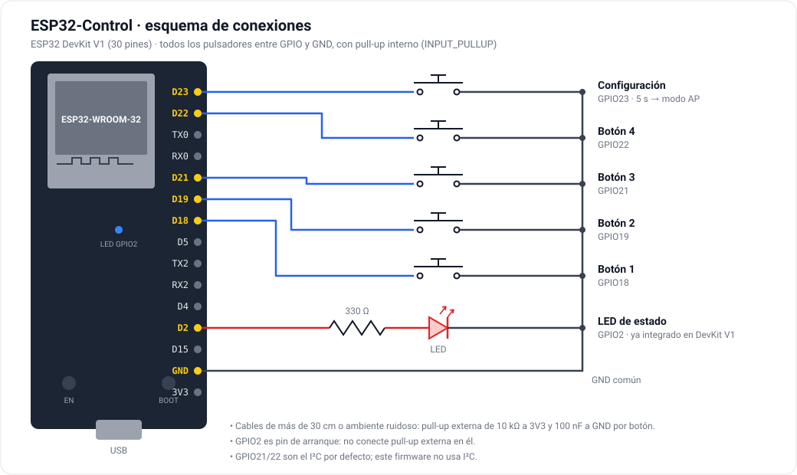
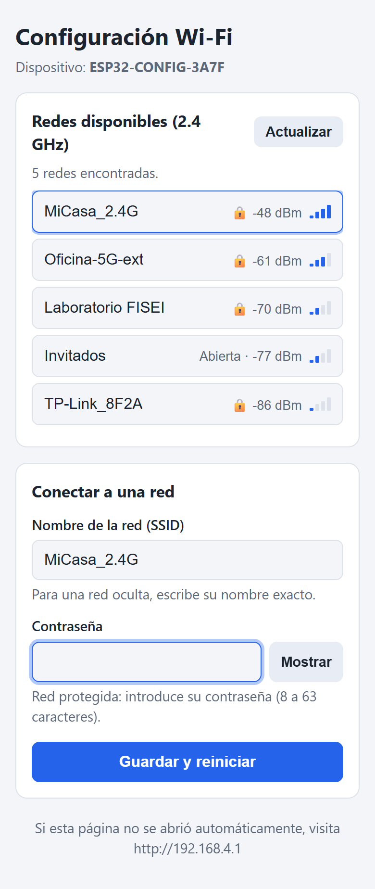
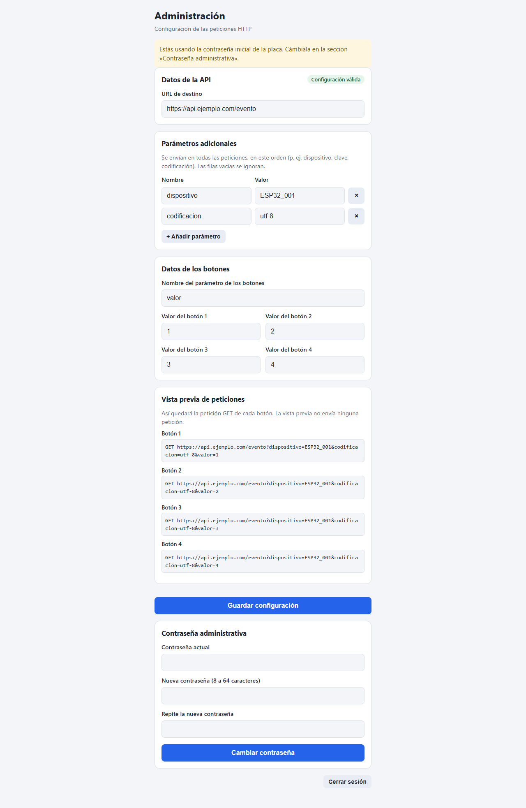
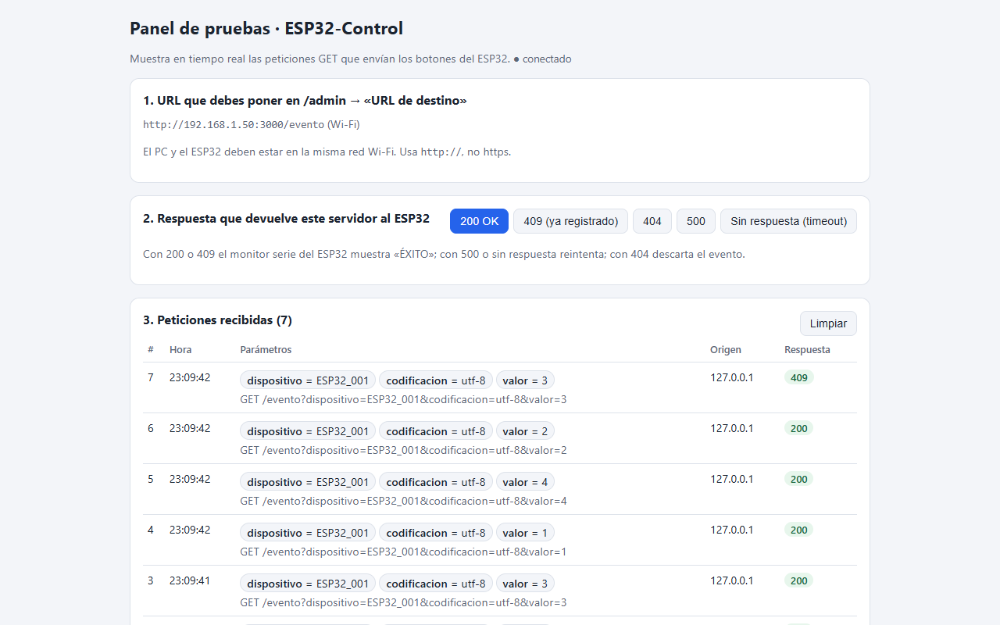
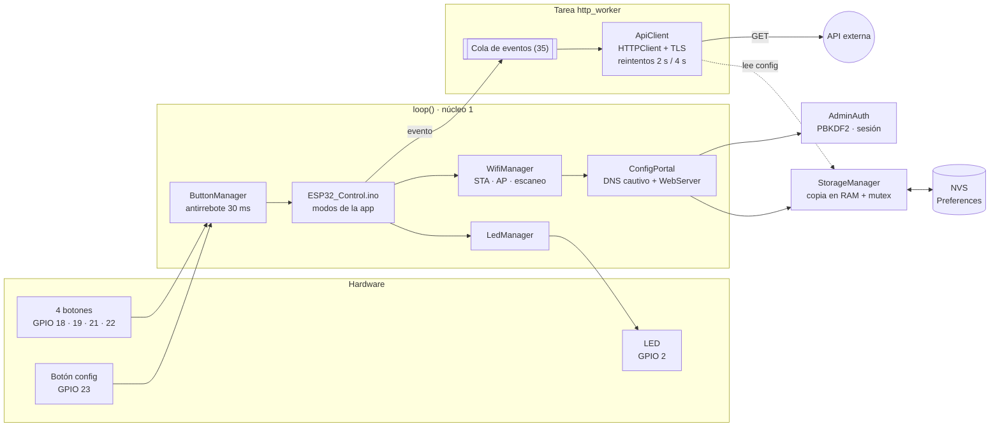
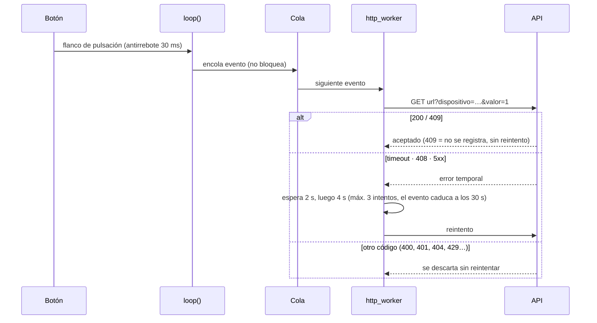
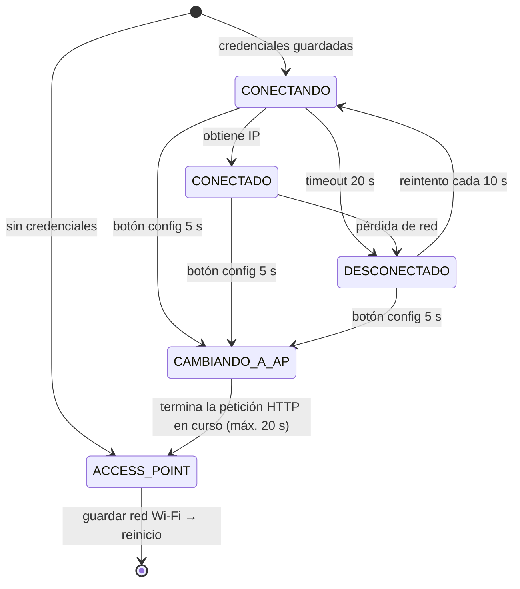

# ESP32-Control

<p>
  
  
  
  
</p>

Firmware para un ESP32 DevKit con **cuatro botones** que envían una petición **HTTP GET** a una API configurable.
Incluye un **portal cautivo** para configurar el Wi-Fi y una página **/admin** protegida con contraseña para configurar las peticiones.

- C++ / Arduino Framework. Se compila y sube con **Arduino IDE 2.x** y el paquete de placas **esp32 de Espressif Systems**.
- **No necesita librerías adicionales.** Todo lo que usa viene con el paquete esp32: `WiFi`, `WebServer`, `DNSServer`, `Preferences`, `HTTPClient` y `WiFiClientSecure`.
- La interfaz web y los certificados TLS van **dentro del firmware** (`PROGMEM`): un único «Subir» y listo, sin LittleFS ni plugins.

**Lo más destacado**

- Peticiones HTTP(S) en una **tarea FreeRTOS** con cola de 35 eventos: el `loop()` nunca espera a la red y las pulsaciones rápidas no se pierden.
- **Reintentos con espera creciente** solo para errores temporales (timeout, 408, 5xx); el resto se descarta sin gastar cupo de la API.
- **HTTPS con validación de certificados** y conexión *keep-alive* entre pulsaciones seguidas.
- `/admin` con contraseña **PBKDF2-HMAC-SHA256**, token de sesión en RAM y bloqueo tras 5 intentos.
- Portal cautivo compatible con Android, iOS y Windows (rutas de detección y DNS propio).

## Vista rápida



| Portal Wi-Fi (teléfono) | Panel `/admin` | Servidor de pruebas |
|---|---|---|
|  |  |  |

<sub>Capturas de la interfaz real servida por `tools/simulador-portal.js` (ver 3.9), con datos de ejemplo.</sub>

### Arquitectura del firmware



### Qué pasa al pulsar un botón



---

## 1. Contenido del proyecto

```
ESP32-Control/
├── ESP32_Control/              ← CARPETA DEL SKETCH (la que se abre en Arduino IDE)
│   ├── ESP32_Control.ino           Programa principal: modos, botones → cola HTTP, LED
│   ├── Config.h                    GPIO, tiempos, límites y opción API_TLS_INSECURE
│   ├── WifiManager.h/.cpp          Estación (conexión/reintentos), AP, escaneo asíncrono
│   ├── ConfigPortal.h/.cpp         DNS cautivo, servidor web, rutas y API JSON
│   ├── AdminAuth.h/.cpp            Contraseña administrativa (PBKDF2), sesión, bloqueo
│   ├── ApiClient.h/.cpp            Tarea FreeRTOS + cola de eventos + HTTPClient
│   ├── UrlUtils.h/.cpp             Validación de URL, URL-encoding, construcción del GET
│   ├── ButtonManager.h/.cpp        Antirrebote, flanco único, pulsación larga de 5 s
│   ├── LedManager.h/.cpp           Patrones LED con millis()
│   ├── StorageManager.h/.cpp       Preferences/NVS + copia en RAM protegida por mutex
│   ├── Log.h                       Registro por Serial
│   ├── CaBundle.h                  Certificados raíz para HTTPS (editable)
│   └── WebAssets.h                 Interfaz web en PROGMEM (GENERADO desde web/)
├── web/                        Fuentes editables de la interfaz
│   ├── index.html, wifi.js         Página Wi-Fi (/)
│   ├── admin.html, admin.js        Página administrativa (/admin)
│   └── styles.css
├── tools/
│   ├── generar_recursos_web.py     Convierte web/ → ESP32_Control/WebAssets.h
│   └── simulador-portal.js         Sirve web/ con una API simulada, sin placa (ver 3.9)
├── docs/                       Esquema de conexiones (SVG) y capturas
├── servidor-pruebas/           Mini servidor Node + panel web para ver las peticiones (ver 9.1)
│   ├── server.js
│   └── index.html
└── README.md
```

Arduino IDE exige que el `.ino` esté en una carpeta con su mismo nombre (`ESP32_Control/ESP32_Control.ino`). Todos los `.h/.cpp` de esa carpeta se compilan automáticamente y aparecen como pestañas en el IDE.

---

## 2. Conexiones físicas

Todos los pulsadores se conectan **entre el GPIO y GND**. El firmware activa las resistencias pull-up internas (`INPUT_PULLUP`), así que no hacen falta resistencias externas.

| Función                       | GPIO | Conexión                                   |
|-------------------------------|------|--------------------------------------------|
| Botón 1                       | 18   | GPIO18 ── pulsador ── GND                  |
| Botón 2                       | 19   | GPIO19 ── pulsador ── GND                  |
| Botón 3                       | 21   | GPIO21 ── pulsador ── GND                  |
| Botón 4                       | 22   | GPIO22 ── pulsador ── GND                  |
| Botón de configuración        | 23   | GPIO23 ── pulsador ── GND                  |
| LED de estado                 | 2    | GPIO2 ── resistencia 330 Ω ── LED (ánodo→cátodo) ── GND |


**Materiales:** ESP32 DevKit V1 (o DevKitC) · 5 pulsadores de 6×6 mm · LED de 3 o 5 mm y resistencia de 330 Ω (solo si la placa no trae LED en GPIO2) · protoboard y cables dupont · cable USB **de datos**.

Notas sobre los pines:

- **GPIO2**: en la mayoría de placas «ESP32 DevKit V1» (DOIT y clones) ya existe un LED azul integrado en GPIO2, así que no hace falta montar uno. La **ESP32-DevKitC** oficial de Espressif *no* tiene LED de usuario: monte uno externo como en la tabla. GPIO2 es un pin de arranque (strapping) que debe estar a nivel bajo o flotante para entrar en modo descarga. Un LED con su resistencia hacia GND es compatible; **no** conecte una resistencia pull-up externa en GPIO2.
- **GPIO18, 19, 21, 22 y 23** no son pines de arranque y admiten pull-up interno. GPIO21/22 son el I²C por defecto, pero este firmware no usa I²C.
- Con cables largos (más de unos 30 cm) o en entornos ruidosos, añada una pull-up externa de 10 kΩ a 3V3 en cada botón. Opcionalmente, un condensador de 100 nF entre el GPIO y GND.

---

## 3. Compilar y subir con Arduino IDE

### 3.1 Instalar el paquete de placas ESP32 (una sola vez)

1. Instale **Arduino IDE 2.x** desde <https://www.arduino.cc/en/software>.
2. Abra **Archivo → Preferencias**. En **«URLs adicionales del gestor de placas»** añada:
   ```
   https://espressif.github.io/arduino-esp32/package_esp32_index.json
   ```
3. Abra **Herramientas → Placa → Gestor de placas**, busque **`esp32`** e instale **«esp32 by Espressif Systems»**.
   - Verificado con la versión **3.3.10**.
   - El código también es compatible con la rama **2.0.x** (comprobado con 2.0.17).

### 3.2 Librerías

**No hay que instalar ninguna librería.** Todas las que usa el firmware forman parte del paquete esp32 anterior.

> No hace falta ArduinoJson, ni WiFiManager, ni ESPAsyncWebServer, ni LittleFS. Si tiene instalada la librería «WiFiManager» (tzapu), no interfiere: el sketch usa su propio `WifiManager.h`, que tiene prioridad por estar en la carpeta del sketch.

### 3.3 Abrir el proyecto

**Archivo → Abrir…** → seleccione `ESP32-Control/ESP32_Control/ESP32_Control.ino`. Se abrirán todas las pestañas (`Config.h`, `WifiManager.cpp`, etc.).

### 3.4 Seleccionar la placa y las opciones

Menú **Herramientas**:

| Opción | Valor |
|---|---|
| Placa | **ESP32 Dev Module** (Placa → esp32 → ESP32 Dev Module) |
| Upload Speed | 921600. Si la subida falla, baje a 460800 o 115200. |
| CPU Frequency | 240 MHz (WiFi/BT) |
| Flash Frequency | 80 MHz |
| Flash Mode | QIO |
| Flash Size | 4MB (32Mb) |
| Partition Scheme | **Default 4MB with spiffs (1.2MB APP/1.5MB SPIFFS)** |
| Core Debug Level | None |
| PSRAM | Disabled |
| Erase All Flash Before Sketch Upload | **Disabled**. «Enabled» borra toda la configuración guardada; ver 3.7. |

El firmware ocupa el **88 %** de la partición de aplicación por defecto, así que cabe sin cambiar nada. Si en el futuro se amplía y no cupiera, elija **Partition Scheme → «Huge APP (3MB No OTA/1MB SPIFFS)»**. Es válido porque el proyecto no usa OTA ni sistema de archivos.

También puede elegir **«DOIT ESP32 DEVKIT V1»** si su placa es de ese modelo: es el mismo chip.

### 3.5 Seleccionar el puerto COM

1. Conecte la placa por USB con un cable **de datos**; algunos cables solo cargan.
2. **Herramientas → Puerto** → elija el `COMx` que aparece al conectar la placa.
3. Si no aparece ningún puerto nuevo:
   - Abra el **Administrador de dispositivos → Puertos (COM y LPT)**.
   - Si la placa aparece como dispositivo desconocido, instale el driver del chip USB-serie de su placa (suele estar impreso cerca del conector USB):
     - **CP210x** (Silicon Labs): <https://www.silabs.com/developers/usb-to-uart-bridge-vcp-drivers>
     - **CH340/CH341** (WCH): <https://www.wch-ic.com/downloads/CH341SER_EXE.html>
   - Desconecte y vuelva a conectar la placa.

### 3.6 Compilar, subir y abrir el monitor serie

1. **Verificar** (✓) para compilar.
2. **Subir** (→) para compilar y grabar.
   - Si aparece `Failed to connect to ESP32: Wrong boot mode detected` o la subida se queda en `Connecting....`, mantenga pulsado el botón **BOOT** de la placa hasta que empiece la escritura.
3. **Herramientas → Monitor Serie**, velocidad **115200 baudios**.

### 3.7 Borrar toda la configuración (restablecimiento de fábrica)

Este procedimiento borra la red Wi-Fi, la configuración de la API y la contraseña administrativa:

1. Ponga **Herramientas → Erase All Flash Before Sketch Upload** en **Enabled**.
2. Suba el firmware.
3. Vuelva a ponerlo en **Disabled**. Si lo deja activado, cada subida borrará la configuración.

### 3.8 Si modifica la interfaz web

Las páginas se editan en `web/`. Después de modificarlas, regenere `WebAssets.h` (requiere Python 3, sin dependencias) y vuelva a subir el firmware:

```
python tools/generar_recursos_web.py
```

`WebAssets.h` **ya viene generado**, así que para compilar y subir **no se necesita Python**.

> **Por qué PROGMEM y no LittleFS:** Arduino IDE 2.x no incluye herramienta para subir archivos a LittleFS; hace falta instalar un plugin aparte y hacer una segunda subida. Con la web incrustada en el firmware basta un único «Subir». Además, la web y el firmware nunca pueden quedar desincronizados.

### 3.9 Probar la interfaz sin placa

`tools/simulador-portal.js` sirve las páginas de `web/` y responde la API interna (`/api/scan`, `/api/admin/…`) con
datos de ejemplo. Sirve para editar la interfaz y ver los cambios al instante, sin compilar ni subir:

```
node tools/simulador-portal.js
```

Abra <http://localhost:4000> (portal Wi-Fi) y <http://localhost:4000/admin> (cualquier contraseña no vacía entra).
Lo que se guarda vive solo en memoria. Cuando la interfaz esté lista, regenere `WebAssets.h` (3.8).

---

## 4. Primer uso

### 4.1 Contraseña administrativa (aprovisionamiento inicial)

La contraseña inicial de `/admin` es **`Admin123!`**. Se define en `Config.h` (`ADMIN_INITIAL_PASSWORD`).

En NVS se guarda solo como hash PBKDF2-HMAC-SHA256 con sal. Mientras no se cambie:

- `/admin` muestra un aviso para que la cambie.
- Se imprime por el **Monitor Serie** (115200 baudios) en cada arranque y cada vez que se activa el portal:

```
==================== APROVISIONAMIENTO /admin ====================
  Contraseña administrativa inicial: Admin123!
  Cámbiela desde /admin; después dejará de mostrarse aquí.
===================================================================
```

Procedimiento:

1. Entre en `/admin` con `Admin123!`.
2. Cámbiela en la sección «Contraseña administrativa». A partir de ese momento solo se conserva el hash de la nueva y ya no se imprime.

Al ser la misma en todas las placas, **cámbiela antes de instalar el dispositivo**. Si se olvida la contraseña definitiva, el restablecimiento de fábrica (3.7) vuelve a dejar `Admin123!`, pero también borra la configuración Wi-Fi y la de la API.

> Una placa que se programó con una versión anterior (que generaba una contraseña inicial aleatoria) y nunca la cambió pasa automáticamente a `Admin123!` en el siguiente arranque. Si ya se había definido una contraseña propia, se respeta.

### 4.2 Configurar el Wi-Fi

1. Sin credenciales guardadas, el ESP32 crea la red abierta **`ESP32-CONFIG-XXXX`** (XXXX = últimos 4 dígitos hexadecimales de la MAC). El LED parpadea con el patrón de AP.
2. Conecte el teléfono a esa red. El sistema debería abrir solo la página de configuración. Si no, abra **http://192.168.4.1** (o **http://wifi.com**).
3. Elija una red de la lista (o escriba el nombre de una red oculta), introduzca la contraseña y pulse **Guardar y reiniciar**.
4. El ESP32 guarda la red en NVS, responde al navegador y se reinicia para conectarse.

### 4.3 Configurar la API (página administrativa)

La página `/admin` solo está disponible con el portal activo. No hay ningún enlace hacia ella desde la página principal.

1. Active el portal: mantenga pulsado el **botón de configuración (GPIO23) durante 5 segundos**. En el primer arranque el portal ya está activo.
2. Conéctese a `ESP32-CONFIG-XXXX` y abra **http://192.168.4.1/admin**.
3. Inicie sesión y complete los campos:

| Campo                                  | Ejemplo                                                      |
|----------------------------------------|--------------------------------------------------------------|
| URL de destino                         | `https://api.ejemplo.com/evento`                             |
| Parámetros adicionales (0 a 8)         | `dispositivo` = `ESP32_001`, `clave` = `abc123`, `codificacion` = `utf-8` |
| Nombre del parámetro de los botones    | `valor`                                                      |
| Botones 1-4                            | `1`, `2`, `3`, `4`                                           |

   Los **parámetros adicionales** son pares nombre = valor que se añaden a todas las peticiones, en el orden de la lista. Se agregan con **+ Añadir parámetro** y se quitan con **×**. Las filas vacías se ignoran; los nombres no pueden repetirse ni coincidir con el parámetro de los botones.

4. Revise la **Vista previa de peticiones** (no envía nada) y pulse **Guardar configuración**.
5. Para volver al funcionamiento normal, reinicie el dispositivo o guarde una red Wi-Fi en `/`.

Con el ejemplo anterior, el botón 1 envía:

```
GET https://api.ejemplo.com/evento?dispositivo=ESP32_001&clave=abc123&codificacion=utf-8&valor=1
```

> Si la placa tenía guardada la configuración de una versión anterior (identificador + parámetro dispositivo), al arrancar se convierte automáticamente en el primer parámetro adicional.

Reglas de construcción de la URL (iguales en el firmware y en la vista previa):

- Los nombres y valores se codifican según RFC 3986: solo `A-Z a-z 0-9 - _ . ~` quedan sin codificar. Así `id 1` pasa a `id%201` y `a&b` pasa a `a%26b`.
- Se conservan los parámetros que ya tenga la URL base: `https://h/p?key=abc` pasa a `https://h/p?key=abc&dispositivo=…&valor=…`.
- Si la URL no tiene ruta, se añade `/`: `http://h:8080` pasa a `http://h:8080/?…`.
- Solo se aceptan `http://` y `https://` en minúsculas, sin espacios, sin caracteres no ASCII sin codificar y sin fragmento `#`.

---

## 5. Funcionamiento

### 5.1 Arranque y modos

| Situación                         | Comportamiento                                                                 |
|-----------------------------------|--------------------------------------------------------------------------------|
| No hay credenciales Wi-Fi         | Se inicia el AP y el portal cautivo automáticamente.                           |
| Hay credenciales Wi-Fi            | Se intenta conectar. **Nunca** se activa el AP por fallos de conexión.         |
| Falla la conexión o se pierde     | Reintento cada 10 s (cada intento dura como máximo 20 s), sin bloquear.        |
| Botón de configuración 5 s        | Se detienen las peticiones HTTP de forma ordenada y se activa el AP.           |
| AP activo                         | Se mantiene hasta guardar una red nueva o reiniciar.                           |

Las credenciales **nunca** se borran automáticamente. Para marcar que existe una red guardada se usa una clave propia en NVS, no la contraseña, de modo que las redes abiertas (sin contraseña) funcionan.

### 5.2 Máquina de estados



- `WifiManager` lleva el estado de la radio (`CONECTANDO`, `CONECTADO`, `DESCONECTADO`, `ACCESS_POINT`).
- `ESP32_Control.ino` lleva el modo de la aplicación (`Station`, `SwitchingToAp`, `AccessPoint`).

### 5.3 LED (GPIO2)

| Estado                  | Patrón                                           |
|-------------------------|--------------------------------------------------|
| Conectado               | Encendido fijo                                   |
| Desconectado/conectando | 500 ms encendido / 500 ms apagado                |
| Access Point            | 100 on · 150 off · 100 on · 1000 off (prioritario)|

Todos los patrones se temporizan con `millis()`, sin `delay()`.

### 5.4 Botones de envío

- Antirrebote de 30 ms. Se genera un único evento en el flanco de pulsación; mantener el botón pulsado no repite.
- Los eventos van a una cola en RAM de 35 posiciones, que consume una tarea FreeRTOS dedicada (`http_worker`). Las pulsaciones rápidas no se pierden mientras hay una petición en curso; si la cola se llena, el evento se descarta y se registra.
- Un evento se **descarta con un mensaje por Serial** en estos casos:
  - el modo AP está activo;
  - no hay Wi-Fi al pulsar;
  - la configuración HTTP está incompleta (el mensaje indica qué falta);
  - la URL es HTTPS y no hay certificados raíz.
- Resultado de la petición:
  - **HTTP 200** = éxito. **HTTP 409** = la API recibió la petición pero no la registra (por ejemplo, `"Sin cobro pendiente de evaluar."`); no se reintenta porque repetirla no cambia nada;
  - **error de conexión, timeout, 408 o 5xx** = fallo temporal: se **reintenta** hasta 3 intentos en total, esperando 2 s y luego 4 s;
  - **cualquier otro código** (3xx, 400, 401, 404, 422, 429…) = se descarta sin reintentar: repetir daría el mismo error, y en el 429 gastaría más cupo del límite de la API (60 peticiones por minuto).
- Una pulsación con más de 30 s de antigüedad se descarta sin enviarla (`HTTP_EVENT_MAX_AGE_MS`), también entre reintentos. Con la red lenta o caída, las pulsaciones nuevas no esperan detrás de otras viejas.
- Los eventos que esperan reintento **no ocupan la cola**: van a una lista aparte de 16 huecos. Mientras esperan, la tarea sigue enviando las pulsaciones nuevas.
- Los límites están en `Config.h` (`EVENT_QUEUE_LENGTH`, `HTTP_MAX_ATTEMPTS`, `HTTP_RETRY_SLOTS`, `HTTP_RETRY_BASE_DELAY_MS`) y los códigos aceptados y reintentables en `isAccepted` / `isRetryable` de `ApiClient.cpp`.
- Timeouts: conexión 5 s, handshake TLS 8 s, respuesta 5 s. No se siguen redirecciones (un 301/302 cuenta como error).
- **Conexión reutilizada (keep-alive):** la conexión HTTPS queda abierta entre peticiones seguidas, así que solo la primera paga DNS + handshake TLS (~1 s) y las siguientes tardan mucho menos. Tras 4 s sin peticiones se cierra (`HTTP_KEEPALIVE_IDLE_MS`), de modo que nunca se usa una conexión vieja. Si el servidor la cerró mientras estaba inactiva, la petición se repite al momento con una conexión nueva, sin gastar un intento.
- **Vigilante:** si una petición lleva más de 60 s sin terminar, el ESP32 se reinicia solo en modo normal (`HTTP_HANG_RESTART_MS`). En modo AP no se aplica, para no cerrar el portal.
- En los errores (y en el 409) se muestra el cuerpo de la respuesta de la API, que suele indicar el motivo.

Ejemplo de registro en el Monitor Serie:

```
[    52311] APP    Botón 1: pulsación aceptada
[    52312] HTTP   Botón 1: GET https://api.ejemplo.com/evento?dispositivo=ESP32_001&valor=1 (intento 1/3, 1 ms desde la pulsación)
[    53140] HTTP   Botón 1: ERROR, la API respondió HTTP 503 (827 ms)
[    53141] HTTP   Botón 1: intento 2/3 en 2000 ms
[    55142] HTTP   Botón 1: GET https://api.ejemplo.com/evento?dispositivo=ESP32_001&valor=1 (intento 2/3, 2830 ms desde la pulsación)
[    55901] HTTP   Botón 1: ÉXITO, HTTP 200 (759 ms)
```

---

## 6. HTTPS y certificados TLS

La validación de certificados está **activada por defecto**. El firmware **no** usa `setInsecure()` salvo que se cambie expresamente `#define API_TLS_INSECURE 0` a `1` en `Config.h` (solo desarrollo).

El archivo **`ESP32_Control/CaBundle.h`** contiene los certificados raíz de confianza en formato PEM, dentro de una cadena `R"CERTS( … )CERTS"`. Se pasa a `WiFiClientSecure::setCACert()`.

Viene con 9 raíces habituales extraídas del almacén de CA de Mozilla:

- ISRG Root X1 y X2 (Let's Encrypt)
- GTS Root R1 y R4 (Google)
- DigiCert Global Root G2
- Amazon Root CA 1
- USERTrust RSA (Sectigo)
- GlobalSign Root CA - R3
- Microsoft RSA Root 2017

**Cuando conozca la API definitiva:**

1. Averigüe qué CA raíz firma su certificado:
   ```
   openssl s_client -connect api.su-dominio.com:443 -servername api.su-dominio.com -showcerts
   ```
   El último certificado de la cadena (o el emisor del último) es el que hay que confiar. También puede verse en el navegador: candado → certificado → ruta de certificación → certificado raíz.
2. Si no está entre los incluidos, abra la pestaña `CaBundle.h` en Arduino IDE y pegue su PEM (`-----BEGIN CERTIFICATE----- … -----END CERTIFICATE-----`) entre los delimitadores. Para reducir memoria, puede dejar **solo** la raíz de su API.
3. Vuelva a subir el firmware.

Recomendaciones:

- Confíe en el **certificado raíz** (válido durante muchos años), no en el certificado del servidor, que caduca cada pocos meses.
- Vigile los avisos de su proveedor sobre cambios de CA raíz.
- Si `CaBundle.h` no contiene certificados, el firmware rechaza las peticiones HTTPS y lo indica por Serial.

**Limitación conocida:** los paquetes esp32 precompilados para Arduino desactivan `CONFIG_MBEDTLS_HAVE_TIME_DATE` (comprobado en 2.0.17). mbedTLS valida la firma y la cadena del certificado, pero **no comprueba las fechas de validez**. Para comprobarlas haría falta sincronizar la hora por NTP y recompilar el core; queda fuera del alcance.

---

## 7. Portal cautivo y rutas

Con el AP activo:

- Un servidor DNS resuelve **cualquier** dominio a 192.168.4.1. El servidor DHCP anuncia el propio ESP32 como DNS.
- El servidor HTTP del puerto 80 decide según la cabecera `Host`:

| Petición                                               | Respuesta                                  |
|--------------------------------------------------------|--------------------------------------------|
| Host ajeno (p. ej. `connectivitycheck.gstatic.com`)    | `302` → `http://192.168.4.1/`              |
| Rutas de detección: `/generate_204`, `/gen_204`, `/hotspot-detect.html`, `/library/test/success.html`, `/connecttest.txt`, `/ncsi.txt`, `/redirect`, `/canonical.html`, `/success.txt` | `302` → `http://192.168.4.1/` |
| `http://192.168.4.1/` o `http://wifi.com/`             | Página de configuración Wi-Fi              |
| `http://192.168.4.1/admin` o `http://wifi.com/admin`   | Página administrativa (**no** se redirige) |
| Ruta desconocida en host propio                        | `404`                                      |

API interna (la usan las páginas):

| Método | Ruta                  | Autenticación | Uso                                  |
|--------|-----------------------|---------------|--------------------------------------|
| GET    | `/api/info`           | no            | Nombre del dispositivo (SSID del AP) |
| GET    | `/api/scan[?refresh=1]` | no          | Escaneo asíncrono de redes           |
| POST   | `/api/wifi`           | no            | Guardar SSID y contraseña, y reiniciar |
| POST   | `/api/admin/login`    | contraseña    | Devuelve un token de sesión          |
| GET/POST | `/api/admin/config` | token         | Leer o guardar la configuración HTTP |
| POST   | `/api/admin/password` | token         | Cambiar la contraseña administrativa |
| POST   | `/api/admin/logout`   | token         | Cerrar la sesión                     |

El token es aleatorio, se envía en la cabecera `X-Auth-Token`, vive solo en RAM y caduca tras 10 minutos de inactividad. Tras 5 contraseñas incorrectas, el acceso se bloquea 30 s.

---

## 8. Decisiones técnicas

| Tema | Decisión |
|---|---|
| HTTP sin bloquear | Tarea `http_worker` en el núcleo 1 con pila de 12 KB (necesaria para TLS). El `loop()` nunca espera a la red. La tarea lee una copia de la configuración protegida por mutex, así que guardar desde `/admin` se aplica sin reiniciar. |
| Cambio ordenado a AP | Se deshabilita el envío, se vacía la cola y se espera (sin bloquear el loop) a que termine la petición en curso. La espera máxima es de 20 s, lo que suman los timeouts. |
| Reconexión | El driver no guarda nada en flash (`WiFi.persistent(false)`) y la reconexión automática está desactivada (`setAutoReconnect(false)`). Los reintentos los hace la máquina de estados propia, así el comportamiento es predecible y nunca se activa el AP solo. |
| AP en modo `WIFI_AP_STA` | La interfaz STA no se conecta a nada: solo sirve para el escaneo asíncrono (`scanNetworks(true)`), que no bloquea el servidor web. |
| Web y certificados en `PROGMEM` | Un único «Subir» en Arduino IDE; sin plugin de LittleFS. |
| Escrituras en NVS | Solo se escribe si el valor cambia. La marca «Wi-Fi configurado» se escribe al final, para que un corte de alimentación no deje una red a medio guardar. |
| Tamaños máximos | SSID 32 bytes · contraseña Wi-Fi 8-63 (o 64 hex) · URL 256 · identificador 64 · nombres de parámetro 32 · valores de botón 64 · contraseña admin 8-64. |

**Compatibilidad entre versiones del paquete esp32.** Hay dos ramas del core (2.x sobre ESP-IDF 4.4 y 3.x sobre ESP-IDF 5) con diferencias que afectan al firmware. Se resolvieron así:

| Diferencia en el core 3.x | Solución en el código |
|---|---|
| `WiFi.macAddress()` no devuelve nada antes de iniciar la radio. | El SSID `ESP32-CONFIG-XXXX` se calcula con `ESP.getEfuseMac()`, válido en ambas versiones. |
| `WiFi.disconnect()` espera hasta 100 ms. | Se usa `WiFi.disconnectAsync()` en 3.x, para no bloquear el loop. |
| El DHCP del AP solo anuncia DNS si se indica. | `softAPConfig()` recibe la IP del ESP32 como DNS en 3.x. |
| `DNSServer` usa AsyncUDP. | Sin cambios: `processNextRequest()` sigue existiendo (vacía). |

- El `.ino` usa funciones `static` en lugar de un namespace anónimo, porque el generador automático de prototipos de Arduino no trata bien los namespaces.

---

## 9. Plan de pruebas

**Estado actual de la verificación:**

- ✅ El sketch **compila sin errores ni advertencias**, con «Compiler warnings: All», usando el mismo motor de Arduino IDE 2 (`arduino-cli` 1.5.1) y el paquete **esp32 3.3.10** con la placa **ESP32 Dev Module**.
  - Flash: 88 % (1 164 432 de 1 310 720 bytes). Última compilación: 24-11-2026.
  - RAM estática: 15 %.
- ✅ También compila sin advertencias con el core **2.0.17**.
- ⚠️ La versión más reciente del paquete (3.3.12) no se ha probado; es una actualización menor de la 3.3.x.
- ✅ La lógica de URL de `UrlUtils.cpp` (validación, codificación, conservación de parámetros) se **ejecutó en el PC** con un compilador nativo sobre 20 casos, y su resultado coincide exactamente con la vista previa de `web/admin.js`.
- ⏳ **Nada se ha probado aún en una placa física.** Los escenarios siguientes están pendientes de comprobar en hardware.

| #  | Escenario | Cómo probarlo | Resultado esperado |
|----|-----------|---------------|--------------------|
| 1  | Primer arranque sin credenciales | Restablecimiento de fábrica (3.7) y abrir el Monitor Serie | Log «no hay credenciales guardadas», AP `ESP32-CONFIG-XXXX`, contraseña admin impresa |
| 2  | AP automático solo sin configuración | Con una red guardada, apagar el router y reiniciar | No aparece el AP; LED 500/500; reintentos cada 10 s |
| 3  | Portal cautivo en teléfono | Conectar Android/iOS al AP | Se abre la página Wi-Fi (depende del sistema; ver limitaciones) |
| 4  | Acceso manual por IP | Navegador → `http://192.168.4.1` | Página Wi-Fi |
| 5  | Escaneo y selección | Pulsar «Actualizar» y tocar una red | La lista se rellena; el SSID se copia al campo |
| 6  | Guardar y reiniciar | Guardar una red válida | Mensaje de éxito; reinicio en unos 1,5 s |
| 7  | Conexión tras reiniciar | Observar el Monitor Serie | `CONECTANDO -> CONECTADO`, IP, LED fijo |
| 8  | Pérdida de Wi-Fi sin AP | Apagar el router con el equipo conectado | «Conexión Wi-Fi perdida», LED 500/500, sin AP |
| 9  | Reconexión automática | Encender el router | Vuelve a `CONECTADO` sin intervención |
| 10 | AP manual | Mantener GPIO23 5 s | «activando el modo Access Point», LED patrón AP; soltar y volver a pulsar no repite |
| 11 | `/admin` con autenticación | `http://192.168.4.1/admin` + contraseña | Formulario con la configuración |
| 12 | Rechazo no autorizado | Contraseña errónea; `curl http://192.168.4.1/api/admin/config` sin token | `401`; tras 5 fallos, `429` durante 30 s |
| 13 | Persistencia HTTP | Guardar en `/admin`, reiniciar y volver a entrar | Se conservan los valores |
| 14 | Envío de los 4 botones | Pulsar cada botón con Wi-Fi y API configurados | Una línea `GET …` por botón con su valor |
| 15 | Parámetros GET | Servidor de pruebas (9.1) | La query coincide con la vista previa |
| 16 | Antirrebote / pulsación larga | Pulsar rápido varias veces y mantener un botón pulsado | Un evento por pulsación; ninguno extra al mantener |
| 17 | Errores HTTP y timeout | Opciones 409/404/500/«Sin respuesta» del servidor de pruebas, o una URL a un host inexistente | 409 = rechazo sin reintento; 404 = descarte sin reintento; 500 y timeout = hasta 3 intentos y descarte |
| 18 | Patrones LED | Observar en los tres estados | Fijo / 500-500 / 100-150-100-1000 |
| 19 | Reinicio conservando configuración | Cortar la alimentación y volver a darla | Se reconecta y conserva la configuración HTTP |
| 20 | `/admin` sin interferencia del portal | Abrir `http://192.168.4.1/admin` y `http://wifi.com/admin` | Se sirve `/admin`, sin redirección a `/` |

### 9.1 Servidor de pruebas (Node.js + panel web)

`servidor-pruebas/` es un mini backend sin dependencias (no hace falta `npm install`) que registra cada GET del ESP32 y lo muestra en un panel web. Sirve para las pruebas 14, 15 y 17.

1. Conecte el PC a la **misma red** (mismo router) a la que se conectará el ESP32.
2. Arranque el servidor:
   ```
   cd servidor-pruebas
   node server.js
   ```
   La consola muestra la URL que hay que poner en `/admin`, por ejemplo:
   ```
   Panel:            http://localhost:3000/panel
   URL para /admin:  http://192.168.1.50:3000/evento     (Wi-Fi)
   ```
   Si aparecen varias IP (VPN, adaptadores virtuales), use la de la red real: Wi-Fi o Ethernet, normalmente `192.168.x.x`.
3. La primera vez, Windows preguntará si permite a Node.js en el firewall: marque **Redes privadas** y acepte.
4. En `/admin` del ESP32 ponga esa URL (con `http://`, no `https://`). Guarde y reinicie el ESP32 para volver al modo normal.
5. Abra el panel `http://localhost:3000/panel` y pulse los botones del ESP32. Cada petición aparece al instante con sus parámetros (`dispositivo`, `valor`…), la IP de origen y la respuesta enviada.

El panel permite elegir qué responde el servidor:

| Opción | Resultado en el Monitor Serie del ESP32 |
|---|---|
| **200 OK** | `ÉXITO, HTTP 200` |
| **409** | `RECHAZADO por la API, no se reintenta, HTTP 409` y la respuesta de la API |
| **404** | `ERROR, la API respondió HTTP 404 … Evento descartado sin reintentar` |
| **500** | `ERROR, la API respondió HTTP 500` y `intento 2/3 en 2000 ms`…; tras el 3.º, `evento descartado tras 3 intentos fallidos` |
| **Sin respuesta** | `ERROR de conexión/timeout: read Timeout` (unos 5 s después) y reintentos como con 500 |

La consola de Node también registra cada petición. Para usar otro puerto en PowerShell: `$env:PORT=8080; node server.js`.

---

## 10. Limitaciones y puntos pendientes de comprobar en hardware

1. **Nada se ha probado en una placa real**: botones, LED, Wi-Fi, portal, NVS y TLS solo se han validado compilando y revisando el código.
2. **Apertura automática del portal**: depende del sistema operativo y no puede garantizarse.
   - Android con «DNS privado» activado o navegadores con DNS-over-HTTPS no usan el DNS del ESP32. Entonces no hay apertura automática y `wifi.com` no resuelve; queda `http://192.168.4.1`.
   - `http://wifi.com` puede fallar si el navegador fuerza HTTPS (modo «solo HTTPS»). Escriba `http://` explícitamente o use la IP.
3. **Seguridad del AP**: la red de configuración es **abierta** por defecto, como es habitual en los portales cautivos. El tráfico del portal es HTTP sin cifrar: la contraseña administrativa y el token viajan en claro dentro de esa red.
   - La contraseña inicial `Admin123!` es igual en todas las placas: cámbiela desde `/admin`.
   - Para cifrar el enlace, defina `AP_PASSWORD` (8 caracteres o más) en `Config.h`.
   - Como alternativa, realice la administración sin otros dispositivos cerca.
   - La página `/` no exige autenticación, por diseño del requisito.
4. **Fechas de los certificados TLS**: no se comprueban (ver sección 6).
5. **Escaneo con clientes conectados**: el escaneo en `AP_STA` recorre los canales durante unos 2-3 s. Algunos teléfonos pueden perder la conexión con el AP un instante.
6. **Petición en curso al pasar a AP**: si una petición HTTP no termina en 20 s (caso extremo de DNS o red), se interrumpe al cambiar la radio a modo AP.
7. **Redes de 5 GHz**: el ESP32 solo trabaja en 2,4 GHz; las redes de 5 GHz no aparecen en la lista.
8. **Redes empresariales** (WPA2-Enterprise / 802.1X) y portales cautivos de terceros (hoteles): no están soportados.
9. **Primer reintento del core**: el core Arduino-ESP32 (2.x y 3.x) hace por su cuenta un único reintento tras el primer fallo de conexión. Es inocuo; la máquina de estados propia sigue gobernando los intentos siguientes.
